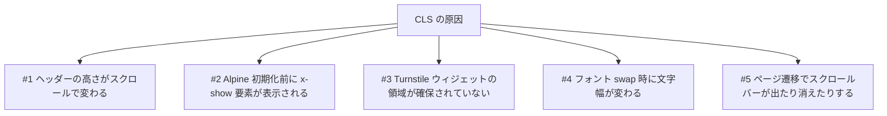

# レイアウトシフト（CLS）修正計画

## 概要
ポートフォリオサイト（Astro 5 / Tailwind CSS v4 / Alpine.js / ClientRouter）で発生しているレイアウトシフトを解消する。

---

## 特定したレイアウトシフトの原因（影響が大きい順）



| # | 場所 | 症状 | 影響 |
|---|---|---|---|
| 1 | [Header.astro](../src/components/Header.astro) L17-21 | `sticky` ヘッダーが 20px スクロールすると `py-6` から `py-4` に変わり、**ページ全体が 16px 上にずれる**。`transition-all` で padding がアニメーションするので、ずれが複数フレームに渡る。スクロールはユーザー入力扱いにならないので **CLS にそのまま加算される** | 大（全ページ） |
| 1b | 同上 | `scrolled` の初期値が `false` 固定。リロードやブラウザバックで途中の位置から表示すると、最初のスクロールで突然高さが変わる | 中 |
| 2 | [FormContact.astro](../src/components/forms/FormContact.astro) L178-196 | 送信ボタンの `x-show="status === 'sending'"` が付いた要素（loader / 「送信中」）に `x-cloak` がない。Alpine 初期化前は**両方のラベルが表示され、ボタン幅が変わる** | 中（contact） |
| 3 | [FormContact.astro](../src/components/forms/FormContact.astro) L169-173 | Turnstile のコンテナが空（高さ 0）。ウィジェット（約 65px）が非同期で描画されると**送信ボタンが下に押し出される** | 中（contact） |
| 4 | [Layout.astro](../src/layouts/Layout.astro) L21-41 / [global.css](../src/styles/global.css) L5 | `swap` なので最初はフォールバックフォントで描画され、Inter に切り替わると**英字の幅と行の高さが変わり、見出しの折り返し位置がずれる**。h1（`font-black` = 900）は特に大きい。preload もないので切り替えが遅い | 中（全ページ） |
| 5 | [global.css](../src/styles/global.css) L119-122 | 長いページ（index）と短いページ（contact）の間を ClientRouter で遷移すると、スクロールバーの有無で**コンテンツが左右に約 15px ずれる**（Windows / マウス接続時の macOS） | 小〜中 |

> [!NOTE]
> 確認して**問題がなかった**箇所：`<Picture>` 画像（寸法は確保済み）、SVG アイコン（viewBox・サイズ指定済み）、テスティモニアルのカルーセル（transform で動かし、高さは最も高いスライドで固定）、モバイルメニュー（`x-cloak` あり）、問い合わせ FAB（`fixed`）。

---

## 未決事項

> [!IMPORTANT]
> **Q1. ヘッダーの縮小アニメーションは残したいか？**
> - **案 A（推奨）**：高さは固定にして、スクロール時は背景・ぼかし・影だけを変える。最もシンプルで CLS はゼロ。
> - **案 B**：縮む見た目を残したい場合は、ヘッダーを `fixed` にして、本文側に固定の `padding-top` を確保する。ヘッダーが縮んでも本文は動かない。ただし本文との間に隙間が出る。

> [!IMPORTANT]
> **Q2. フォント対策の強さ**
> - **案 A（推奨）**：よく使うウェイト（400 / 700 / 900）を preload し、メトリクスを Inter に合わせたフォールバックフォント（`size-adjust` など）を定義する。swap 時のずれがほぼ消える。
> - **案 B**：`font-display: optional` に変更する。シフトはゼロになるが、Inter が表示されないことがある。ClientRouter を使っているため、一度フォールバックになると、フルリロードするまで Inter に切り替わらない可能性がある。

> [!WARNING]
> **Q3. 自動テスト**：現在テストの仕組みはない。Playwright を devDependency に追加して CLS を測定するテストを入れるか、手動（Lighthouse / DevTools）での確認だけにするか。

---

## 修正内容

### #1 ヘッダー（案 A 前提）

#### [MODIFY] [Header.astro](../src/components/Header.astro)
```diff
 <header
-	x-data="{ open: false, scrolled: false }"
+	x-data="{ open: false, scrolled: window.scrollY > 20 }"
 	@keydown.window.escape="open = false"
 	@scroll.window="scrolled = window.scrollY > 20"
-	class="sticky top-0 z-40 transition-all duration-300"
+	class="sticky top-0 z-40 transition-[background-color,box-shadow,backdrop-filter] duration-300"
 	:class="scrolled ? 'bg-white/80 backdrop-blur-lg shadow-sm' : 'bg-transparent'"
 >
-	<div class="container py-6" :class="scrolled && 'py-4'" >
+	<div class="container py-5">
```
- padding を固定にして、高さが変わらないようにする（`py-5` は今の 6 と 4 の中間。見た目に合わせて調整する）
- transition の対象を色・影・ぼかしだけにする
- `scrolled` の初期値を実際のスクロール位置から取るようにする（1b の対策）

### #2・#3 問い合わせフォーム

#### [MODIFY] [FormContact.astro](../src/components/forms/FormContact.astro)
```diff
 			<div
 				id="contact-turnstile"
-				class="cf-turnstile"
+				class="cf-turnstile min-h-[65px]"
 				data-sitekey={turnstileSiteKey}
 			></div>
@@
-				<span x-show="status === 'sending'" class="loader inline-block mr-2"></span>
+				<span x-show="status === 'sending'" x-cloak class="loader inline-block mr-2"></span>
@@
-				<span x-show="status === 'sending'">{t("page.contact.form.sending", locale)}</span>
+				<span x-show="status === 'sending'" x-cloak>{t("page.contact.form.sending", locale)}</span>
```
- 65px は Turnstile の通常サイズ（300×65）。compact 表示にする場合は 140px にする。

### #4 フォント（案 A 前提）

#### [MODIFY] [Layout.astro](../src/layouts/Layout.astro)
```diff
+const preloadFonts = ["inter-v18-latin-regular.woff2", "inter-v18-latin-700.woff2", "inter-v18-latin-900.woff2"];
+const interFallbackFace =
+	`@font-face{font-family:"Inter Fallback";src:local("Arial");size-adjust:107.4%;ascent-override:90.2%;descent-override:22.5%;line-gap-override:0%;}`;
@@
+		{preloadFonts.map((file) => (
+			<link rel="preload" as="font" type="font/woff2" href={`${assetBase}fonts/inter/${file}`} crossorigin />
+		))}
-		<style is:inline set:html={interFontFaces}></style>
+		<style is:inline set:html={interFallbackFace + interFontFaces}></style>
```

#### [MODIFY] [global.css](../src/styles/global.css)
```diff
-	--font-inter: "Inter", "Hiragino Kaku Gothic ProN", "Hiragino Sans", "Meiryo", "sans-serif";
+	--font-inter: "Inter", "Inter Fallback", "Hiragino Kaku Gothic ProN", "Hiragino Sans", "Meiryo", sans-serif;
```
- 日本語の文字は Inter にないので、今まで通り Hiragino / Meiryo で表示される（変化なし）。補正の対象は英字部分だけ。
- `"sans-serif"` を引用符で囲むと総称ファミリーとして扱われないため、ついでに引用符を外す。
- 補正値（size-adjust など）は Inter と Arial の一般的な値。実装時に DevTools で swap 前後を比べて微調整する。

### #5 スクロールバーによる横ずれ

#### [MODIFY] [global.css](../src/styles/global.css)
```diff
+html {
+	scrollbar-gutter: stable;
+}
```

---

## 検証方法

### ビルド確認
```bash
pnpm build && pnpm preview
```

### CLS の測定（実装前と実装後で比較）
1. ブラウザで `/`・`/about-me/`・`/contact/`（ja / en）を開き、`PerformanceObserver({type: 'layout-shift', buffered: true})` で合計 CLS を取得する。
2. 各ページを最下部までスクロールし、スクロール中のシフトが 0 になっていることを確認する（#1）。
3. `/contact/` でボタン幅と Turnstile 周辺のシフトがないことを確認する（#2・#3）。
4. DevTools のネットワーク速度を「Slow 4G」にして、フォント切り替え時に見出しが動かないことを確認する（#4）。
5. index ↔ contact を遷移して横ずれがないことを確認する（#5）。
6. 目標：全ページで **CLS < 0.05**（Good の基準は 0.1）。

### 手動確認
- ヘッダーの見た目（固定の `py-5`）がデザイン的に問題ないか
- 実機（スマホ）で問い合わせフォームの表示がおかしくないか
